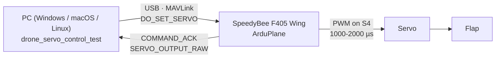
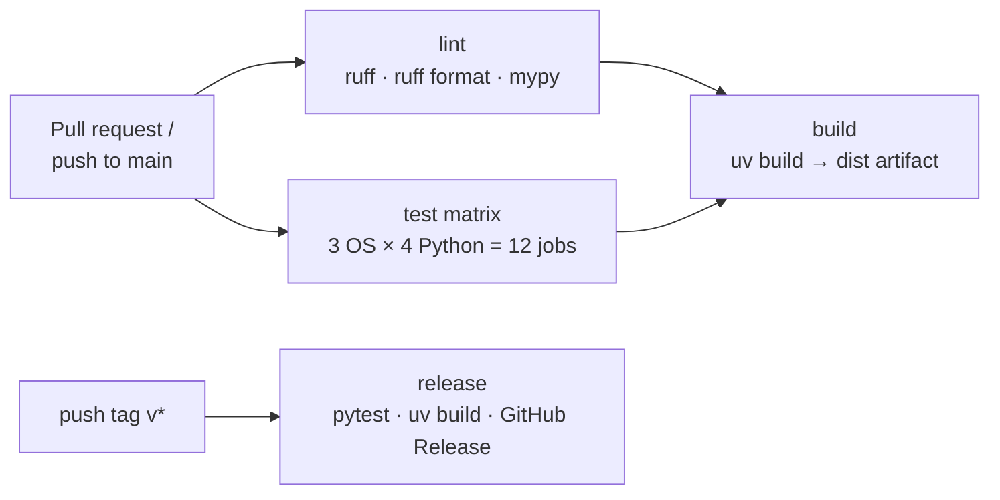

# drone-servo-control-test

[](https://github.com/rlagoy/drone-servo-control-test/actions/workflows/ci.yml)

Flap-control component for a fixed-wing drone, plus the tests that verify it: a computer sends
a MAVLink command to an ArduPilot flight controller (SpeedyBee F405 Wing), which outputs PWM to a
servo that deflects the flap.



The repo shows two levels of testing:

| Level | What runs | Needs hardware | Command |
|---|---|---|---|
| Unit | `MAVLinkDevice` with pymavlink mocked out | No | `uv run pytest tests/test_mavlink_device_unit.py` |
| Component (software) | Real MAVLink against a **simulated flight controller** | No | `uv run pytest` |
| Hardware-in-the-loop | Real SpeedyBee + servo, bench measurements | Yes | `uv run servo-bench-test` / `uv run pytest -m hardware --device auto` |

**Full walkthrough, including flight controller setup and firmware updates:
[docs/SETUP_AND_TUTORIAL.md](docs/SETUP_AND_TUTORIAL.md).**

## Quick start

Install [uv](https://docs.astral.sh/uv/getting-started/installation/), then:

```bash
git clone https://github.com/rlagoy/drone-servo-control-test.git
cd drone-servo-control-test
uv sync                       # creates .venv with Python + all dependencies
uv run pytest                 # software tests, no hardware needed
```

With the flight controller plugged in:

```bash
uv run servo-bench-test --list-ports   # the flight controller is marked with *
uv run servo-bench-test                # auto-detect the port, or pass COM5 / /dev/ttyACM0 / ...
```

No hardware but want to see the bench test run? Start the simulator in one terminal and point
the bench test at it from another:

```bash
uv run python tests/fake_autopilot.py
uv run servo-bench-test udpin:127.0.0.1:14550
```

## Layout

```
src/drone_servo_control_test/
    mavlink_device.py   MAVLinkDevice: connect, heartbeat, COMMAND_LONG, DO_SET_SERVO, telemetry
    ports.py            cross-platform auto-detection of the flight controller's USB port
    main.py             servo-bench-test: interactive hardware bench procedure
tests/
    fake_autopilot.py   simulated ArduPilot FC (MAVLink over local UDP)
    test_*_unit.py      mocked unit tests
    test_*_sim.py       component tests against the simulator
    test_main.py        bench procedure + CLI against the simulator
    test_ports.py       port detection with Windows/macOS/Linux port lists
    test_hardware.py    HIL tests (skipped unless --device is given)
docs/
    SETUP_AND_TUTORIAL.md
    speedybee_f405wing_servo_test.param
```

## Development

```bash
uv run pre-commit install     # once: run ruff, mypy, etc. on every commit
uv run ruff check . && uv run ruff format .
uv run mypy
uv run pytest --cov
```

Contributions: branch, open a pull request, and make sure CI is green. All commits must be
signed and show as **Verified** on GitHub (set up commit signing with a key added to your GitHub
account).

## CI/CD



**`ci`** ([`.github/workflows/ci.yml`](.github/workflows/ci.yml)) runs on every pull request,
every push to `main`, and on demand (*Actions → ci → Run workflow*). A newer push to the same
branch cancels the run already in progress.

| Job | Runs on | What it does |
|---|---|---|
| `lint` | Ubuntu | `uv sync --locked` (fails if `uv.lock` is out of date), `ruff check`, `ruff format --check`, `mypy` (strict) |
| `test` | Ubuntu, Windows, macOS × Python 3.11, 3.12, 3.13, 3.14 | `uv run pytest --cov`: unit tests and simulator tests; hardware tests are deselected. Fails below 90 % coverage. The Ubuntu / 3.13 job uploads `coverage.xml` as an artifact. The jobs don't stop each other on failure, so you see every OS/Python combination that breaks. |
| `build` | Ubuntu, after `lint` and all `test` jobs pass | `uv build`, uploads the wheel and sdist as the `dist` artifact |

The hardware-in-the-loop tests can't run on GitHub's runners; run them locally with the flight
controller plugged in (`uv run pytest -m hardware --device auto`) before merging changes to
`mavlink_device.py`.

**`release`** ([`.github/workflows/release.yml`](.github/workflows/release.yml)) runs when a
`v*` tag is pushed: it runs the tests, builds the package and creates a GitHub Release with the
wheel and sdist attached and generated release notes.

```bash
git tag -s v0.2.1 -m "v0.2.1"
git push origin v0.2.1
```

**Dependabot** ([`.github/dependabot.yml`](.github/dependabot.yml)) opens monthly PRs for
GitHub Actions and Python dependency updates (dev tools grouped into one PR); `ci` checks each.

**pre-commit** ([`.pre-commit-config.yaml`](.pre-commit-config.yaml)) runs the same ruff and
mypy checks plus `uv lock` and whitespace/YAML/TOML checks locally on every commit, so most
`lint` failures are caught before you push.
